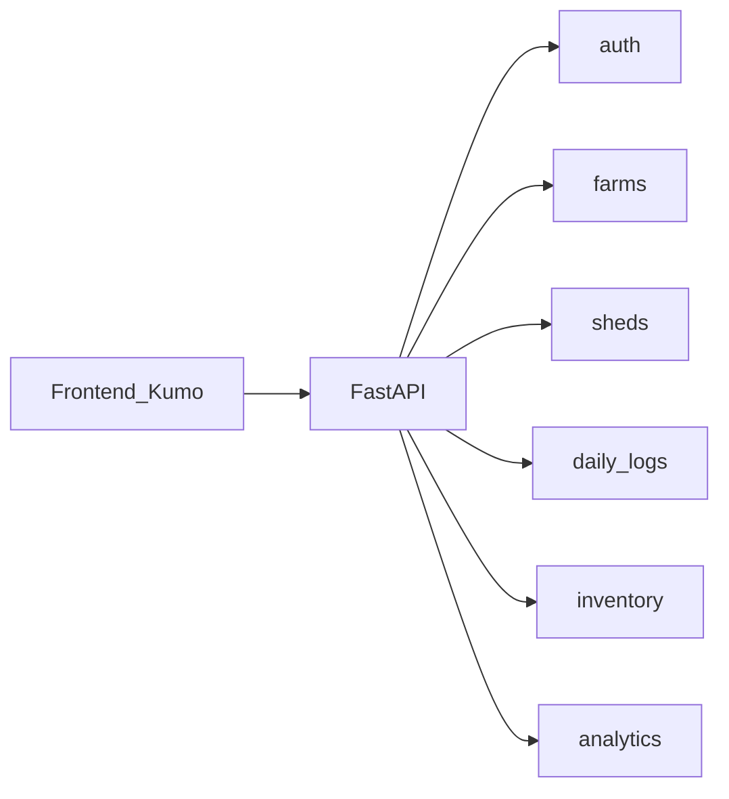

# Architecture — Poultry Farm MVP

Source of product requirements: [PRD-poultry-farm-MVP.md](PRD-poultry-farm-MVP.md).

## Stack (current)

| Layer | Choice |
|-------|--------|
| Frontend | Vite + React + TypeScript + [Kumo UI](https://kumo-ui.com/) + Tailwind |
| Backend | FastAPI + Uvicorn |
| Database | Postgres 16 (Docker Compose) + SQLAlchemy / psycopg |
| Ports | API `8010`, UI `5173` |

Scaffold lives in `frontend/` and `backend/`. Persistence and auth are not implemented yet; this doc defines the target shape.

## High-level modules



## Frontend routes (target)

| Route | Role | Purpose |
|-------|------|---------|
| `/login` | all | Authenticate |
| `/farms` | Owner, Manager | List farms |
| `/farms/:farmId` | Owner, Manager | Farm overview + sheds |
| `/farms/:farmId/sheds/:shedId` | Manager (write), Owner (read) | Shed detail + daily entry |
| `/farms/:farmId/godown` | Manager (write), Owner (read) | Feed stock |
| `/analytics` | Owner | Month / prev month / year views |

Use Kumo components. Prefer routes that match the domain hierarchy above.

## Backend domains (target)

| Package / area | Responsibility |
|----------------|----------------|
| `auth` | Login, JWT or session, current user + role + `customer_id` |
| `farms` | CRUD farms for customer |
| `sheds` | CRUD sheds under a farm |
| `daily_logs` | Upsert daily shed log (birds, eggs) |
| `inventory` | Godown feed stock / movements |
| `analytics` | Aggregations for current month, previous month, year |

All endpoints must enforce **customer isolation** via `customer_id` from the authenticated user.

## Data model (logical)

| Entity | Key fields |
|--------|------------|
| **Customer** | id, name |
| **User** | id, customer_id, email, role (`owner` \| `farm_manager`), password hash |
| **Farm** | id, customer_id, name, location (optional) |
| **Shed** | id, farm_id, name, number, capacity (optional) |
| **Breed** | id, customer_id (NULL = system), name |
| **BreedStandard** | breed_id, age_week, hdep_pct, hhe_cum, mort_cum_pct, feed_g, egg_wt_g, body_wt_g |
| **Flock** | id, shed_id, breed_id, hatch_date, placed_date, birds_placed, live_birds, source, chick_cost, depleted_on — one active (`depleted_on IS NULL`) per shed; age week + stage derived |
| **DailyShedLog** | id, shed_id, flock_id, date, eggs_collected, deaths, notes, recorded_by_user_id |
| **BirdAdjustment** | id, shed_id, flock_id, at, previous_count, live_bird_count, reason, user_id |
| **FeedMovement** | id, farm_id, direction (`in`\|`out`), qty_kg, date, note, user_id |

Unique constraint: `(shed_id, date)` on `DailyShedLog` so one log per shed per day. Godown stock = sum(in) − sum(out) from `FeedMovement`.

## Permission matrix

| Action | Owner | Farm Manager |
|--------|-------|--------------|
| Manage farms/sheds | yes | yes (or read-only farms if later restricted — default MVP: Manager can enter data on assigned farms; Owner full CRUD) |
| Write daily shed log | read preferred | yes |
| Update godown feed | read preferred | yes |
| View analytics (month / prev / year) | yes | no (or limited summary only — **MVP: Owner only**) |
| Monitor latest status | yes | yes (own farms) |

Clarify assignment later if Managers are limited to specific farms; until then, Managers see all farms under their customer.

## Auth sketch

- JWT (Bearer) or HTTP-only session cookie — pick one in an ADR when implementing ([decisions.md](decisions.md)).
- Requests carry authenticated `user_id`, `role`, `customer_id`.
- Analytics routes: require `role == owner`.
- Write routes for logs/inventory: require `farm_manager` or `owner` (Owner write optional).

## API boundaries (illustrative)

```
POST   /api/auth/login
GET    /api/farms
POST   /api/farms
GET    /api/farms/{farm_id}/sheds
POST   /api/farms/{farm_id}/sheds
PUT    /api/sheds/{shed_id}/daily-logs/{date}
GET    /api/sheds/{shed_id}/daily-logs/{date}
PUT    /api/sheds/{shed_id}/live-count
GET    /api/farms/{farm_id}/godown
POST   /api/farms/{farm_id}/godown/movements
GET    /api/dashboard?farm_id=&from=&to=
GET    /api/dashboard/export.pdf?farm_id=&from=&to=
GET    /api/analytics/portfolio?from=&to=
GET    /api/analytics/compare?level=shed|farm&from=&to=
GET    /api/analytics/sheds/{shed_id}?from=&to=
GET    /health
```

Dashboard and analytics aggregate real `DailyShedLog`, live bird counts, and godown stock for the inclusive `[from, to]` window (max 366 days). Analytics end-cap is yesterday; Monitor may include today.

## Repo map

```
frontend/          React app (Vite)
backend/           FastAPI app (main.py today)
docs/              PRD, architecture, roadmap, decisions
agent_docs/        Agent deep-dives
specs/             Per-feature specs / plans
AGENTS.md          Agent entry
MEMORY.md          Active phase memory
```

## Constraints for agents

- Do not invent features outside [PRD-poultry-farm-MVP.md](PRD-poultry-farm-MVP.md).
- Prefer small vertical slices per [roadmap.md](roadmap.md).
- Match existing scaffold style in `frontend/src` and `backend/main.py`.
